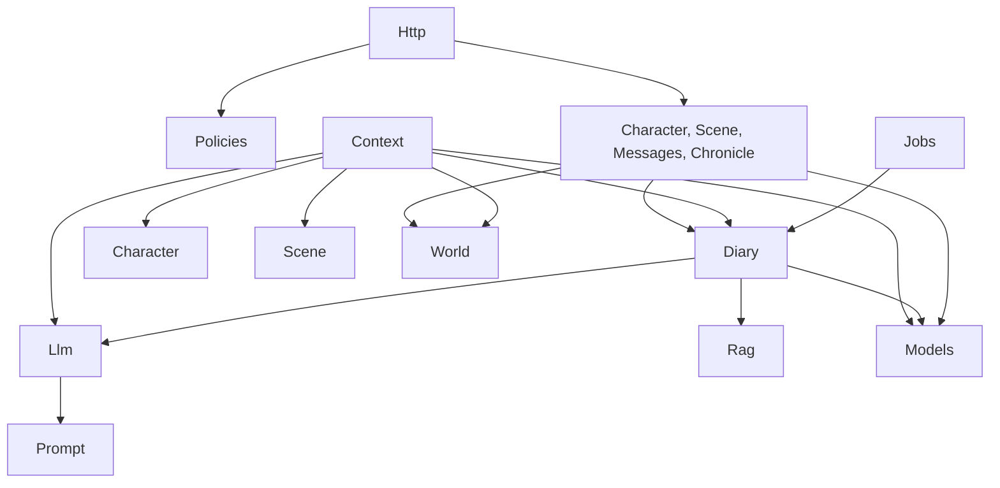

# Архитектура trpg_chat_helper

Документ описывает текущую архитектуру после этапа 3 (несколько хроник на инстансе). План миграции — `docs/plan-2026-10-16.md`, решения — `docs/adr/`.

## 1. Слои

Модульные папки в корне `app/` по стандарту Laravel. Без DDD-слоёв и без `app/Domain` (ADR-001).

| Слой | Ответственность | Чего не делает |
|---|---|---|
| `Http/Controllers` | authorize → вызов сервиса → Resource | не открывает транзакции, не пишет Eloquent-запросы (кроме route model binding), не сериализует руками |
| `Http/Requests` | валидация и нормализация входа | не авторизует, не ходит в БД сверх правил `exists`/`unique` |
| `Http/Resources` | вся сериализация JSON | не содержит логики |
| `Policies` | единственное место авторизации | — |
| Модули (`Character`, `Scene`, `Messages`, `Diary`, `World`, `Chronicle`) | бизнес-логика, транзакции, доменные исключения | не вызывают `abort()`, не бросают `HttpException`, не знают о HTTP |
| `Context` | сборка промпта Copilot из провайдеров | только читает другие модули |
| `Llm`, `Rag`, `Prompt` | интеграции: DeepSeek, Ollama, промпты | не знают о домене сверх DTO |
| `Models` | связи, casts, scopes | без `abort()`, без `app()` |
| `Observers` | хуки моделей с DI (задача 029) | — |
| `Jobs` | тонкая обёртка над методом сервиса | не содержат логики |

## 2. Направление зависимостей

Правила:
- Ни один модуль не импортирует `App\Context\*`. `DiaryPreviewService` живёт в `Context`.
- Исключение: `App\Observers\MessageObserver` → `App\Context\TokenEstimator` (ADR-001 п. 4; осознанное чтение токенов сообщения вне сборки Copilot).
- `dispatch()` — только из `Diary/DiaryScheduler`. `Messages` и `Scene` вызывают его методы.
- `Messages` не пишет в таблицу дневника, а вызывает метод `Diary`.
- DI — только через конструктор. `app()`/`resolve()` — только в service providers.

## 3. Границы модулей

- **Character** — лист персонажа: идентичность, место (клан, секта), черты, дисциплины, биография, архив. Гавани нет (ADR-002, задача 008).
- **Scene** — игровые сессии, сцены, участники, контекст сцены. `ActiveSceneResolver` — единственный поиск активной сцены.
- **Messages** — создание, редактирование, удаление сообщений.
- **Diary** — L0/L1, retrieval, persistence, `DiaryScheduler`. Единственный владелец `character_diary_entries`.
- **Context** — `ContextAssembler` (не трогать без задачи), провайдеры, `DiaryRenderer`, `LineTrimmer`, `TokenEstimator` (в Context, ADR-001 п. 4), `DiaryPreviewService`.
- **Llm** — `ChatProvider`, `DeepSeekChatProvider`, `NpcCopilotService` (два прохода topics → reply).
- **Rag** — `EmbeddingProvider`, Ollama, `VectorLiteral`.
- **World** — `WorldEntityService` (создание identity, `assertSameChronicle`), `WorldRelationService` (только чтение). ADR-002.
- **Chronicle** — членство и приглашения: `ChronicleService`, `InvitationService`, `CurrentChronicle` (хроника из параметра маршрута `{chronicle}`). `ChroniclePolicy` лежит в `app/Policies` (ADR-007).

## 4. Модель данных

**Иерархия хроники:** `chronicles` → `game_sessions` → `scenes` → `messages`. Участники сцены — `scene_participants` с курсорами `entered_message_id`, `left_message_id`, `last_diary_message_id`.

**Членство:** `chronicle_members` (роль `storyteller` или `player`, `joined_at`, `left_at`, уникальность пары хроника–пользователь) и `chronicle_invitations` (ссылка-код, без почты). Пользователь входит в хронику членством. Персонаж игрока ссылается на это членство составным FK.

**Общий PK `world_entities`.** Персонаж и локация — это строка `world_entities` (identity: `chronicle_id`, `entity_type`, `canonical_name`) плюс строка типизированной таблицы (`characters`, `locations`) с тем же `id`. Связь — составной FK `(id, entity_type)` и CHECK на тип. После ADR-002 типов два: `character`, `location`.

**Канон против хроники:**
- `canon_*` — справочник VtM, только чтение, заполняется сидерами идемпотентным upsert.
- `chronicles`, `chronicle_members`, `chronicle_invitations`, `world_*`, `characters`, `scenes`, `messages`, `character_diary_entries` — данные хроники.
- Хроника ссылается на канон (`clan_id`, `sect_id`, `discipline_id`), обратных ссылок нет.

**Инварианты в PostgreSQL** (должны пережить любую правку миграций, см. задачу 015):
- триггеры: `prevent_world_entity_delete`, `prevent_biography_version_mutation`, `enforce_character_power_level`, `enforce_character_discipline_power_level`;
- частичные уникальные индексы: одна активная сессия (`game_sessions_single_active`, `game_sessions_one_active_per_chronicle`), одна активная сцена в сессии (`scenes_single_active_per_session`), одно текущее участие (`scene_participants_current_unique`), одна активная связь (`world_relations_active_unique`), один активный персонаж игрока на пользователя в хронике (`characters_one_active_player_per_chronicle`: `(chronicle_id, user_id)` при `character_type = 'player'` и `is_active`);
- составной FK `characters_chronicle_member_foreign`: `(chronicle_id, user_id)` → `chronicle_members`;
- CHECK-ограничения на типы и роли (`characters_type_check`, `characters_player_user_check`, `scene_participants_role_check`, `chronicle_members_role_check`, `chronicle_invitations_role_check` и др.);
- pgvector `vector(1024)` с индексом HNSW в `character_diary_entries`.

**Миграции:** до первого релиза правятся существующие файлы, БД пересоздаётся `migrate:fresh` (ADR-004).

## 5. Потоки

**Copilot:** `POST /api/chronicles/{chronicle}/copilot/drafts` → `CopilotController` → `NpcCopilotService`:
1. проход topics: лёгкий контекст → список тем;
2. проход reply: `ContextBuilder` → `ContextAssembler` опрашивает провайдеров. Обязательные: system, identity, scene, storyteller prompt, closing, recent messages. Опциональные (в пределах бюджета токенов): direct_relations, personality, biography, lore, diary;
3. `DeepSeekChatProvider` → разбор JSON → 3 черновика → запись `CopilotRequest` с метаданными сборки (включённые и отброшенные секции, токены).

**Дневник:**
- каждые N сообщений (`config/diary.php`, ключ `write_threshold`) — порог проверяет `DiaryScheduler::scheduleForScene`, его вызывает `MessageService`; прямой вызов `DiaryWriterService::writeForScene` порог не проверяет и пишет всё накопленное после курсора участника;
- `WriteDiaryJob` → `DiaryWriterService::writeForScene` (L0 по каждому NPC сцены, сдвиг `last_diary_message_id`);
- уход NPC из сцены — `WriteFinalDiaryJob` → `writeFinalForNpc` (только `CharacterType::Npc`; у PC финальная L0 не ведётся);
- закрытие сцены — `SummarizeSceneDiaryJob` → дописать L0 + L1-сводка;
- чтение — `DiaryProvider` → `DiaryRetrievalService`: последняя запись + до двух семантически близких, из пула исключены записи, попадающие в окно recent messages.
- задачи `ShouldBeUnique`, выполняются воркером (`worker`).

## 6. Авторизация

Одна Policy на модель: `CharacterPolicy`, `ScenePolicy`, `GameSessionPolicy`, `MessagePolicy`, `CharacterDiaryEntryPolicy`, `ChroniclePolicy`, `CopilotPolicy` (ADR-003). Вызов — `->can()` на маршруте или `$this->authorize()` в контроллере.

Роль берётся из членства в хронике. Рассказчик хроники — `User::isStorytellerIn(Chronicle)` (активное членство с ролью `storyteller`). Для уже загруженной модели Policy берёт хронику из неё (`$scene->gameSession->chronicle`, хроника персонажа, сессии, записи дневника). `ChroniclePolicy` проверяет саму хронику: `view` — активное членство, создание и отзыв приглашения — `isStorytellerIn`.

### Маршруты

Коллекции стоят под `/api/chronicles/{chronicle}/...`: активная сессия, сообщения, персонажи, создание сессии, черновики Copilot. Рядом, тоже с `{chronicle}`: просмотр хроники, создание и отзыв приглашения. Плоские маршруты остаются по модели: `/scenes/{scene}`, `/characters/{character}`, `/messages/{message}`, `/diary-entries/{diaryEntry}`, `/game-sessions/{gameSession}/scenes`. Принятие приглашения — `POST /api/invitations/{token}/accept`.

`CurrentChronicle` читает параметр `{chronicle}` текущего маршрута. Контроллеры коллекций вызывают `authorize('view', chronicle)` — это `ChroniclePolicy`. На плоском маршруте отказ даёт Policy модели.

## 7. Ошибки

`App\Exceptions\DomainException` (ADR-005): `NotFoundException` (404), `ConflictException` (409, в том числе `MixedChronicleException` и неизменяемая сцена), `InvalidInputException` (422, тело с `message` и `errors` как у валидации Laravel). Авторизация — Policies (403), не доменные исключения.
Маппинг для `api/*` — `bootstrap/app.php`: в JSON уходит `message`, а у `InvalidInputException` ещё пустой `errors`. Поле `chronicle_id` в 409 на принятие приглашения туда не входит. Его добавляет `ChronicleInvitationController`, если у `InvitationUnavailableException` задан id хроники (пользователь уже участник, в том числе при отозванном приглашении).

## 8. Что не вводим сейчас

Эти решения приняты сознательно. Этап 3 завершён. Предложения вернуться к ним рассматриваются только с новым ADR.

- **Стили фронта.** Остаётся глобальный `frontend/src/styles.css`. Удаляются только стили мёртвых компонентов. Полная переработка UI — отдельный проект: она меняет всё визуальное поведение и не снижает архитектурный долг, ради которого идёт миграция.
- **Политика логирования.** Не вводим отдельный канал, формат или обёртку. Действует простое правило уровней: `INFO` — аудит штатных событий (`diary.write.npc_done`), `WARNING` — восстановимые сбои (LLM вернул невалидный JSON, применён fallback), `ERROR` — то, что требует внимания человека (запись дневника не создана). Ключ события — `module.action.result`.
- **Фронтовые тесты.** E2E и компонентные тесты не вводим. Опора — Feature-тесты backend на каждый маршрут, `npm run build` без ошибок и ручной прогон экранов из DoD задачи. При текущем наборе экранов стоимость поддержки E2E выше пользы.
- **Pinia.** Глобального состояния мало (пользователь в `auth.js`, текущая хроника в composable `useCurrentChronicle`). Store-слой избыточен.
- **Rector.** Массовые автоматические переписывания противоречат принципу атомарных задач с ревью.
- **Deptrac.** Направление зависимостей держится правилами `.cursor/rules/backend.mdc` и ревью. При необходимости — Pest arch-тесты позже.
- **CI-матрица.** Одна версия PHP, одна БД, один разработчик. Достаточно локального DoD.
- **`declare(strict_types=1)`.** См. ADR-006.

## 9. ADR

| № | Тема | Статус |
|---|---|---|
| [001](adr/001-modules-and-dependencies.md) | Модульная структура и направление зависимостей | Accepted |
| [002](adr/002-world-reduction.md) | Сокращение World | Accepted |
| [003](adr/003-authorization-policies.md) | Авторизация только через Policies | Accepted |
| [004](adr/004-migrations-policy.md) | Политика миграций | Accepted |
| [005](adr/005-domain-exceptions.md) | Доменные исключения и единый маппинг | Accepted |
| [006](adr/006-tooling.md) | Инструменты: PHPUnit, Pint, Larastan | Accepted |
| [007](adr/007-chronicle-membership.md) | Членство в хрониках | Accepted |
