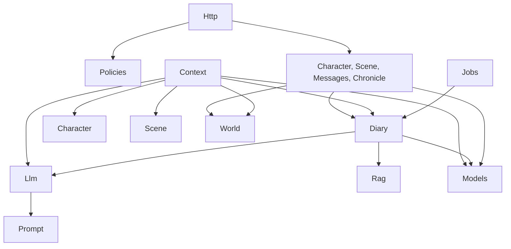
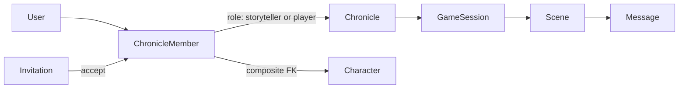

# Целевая архитектура и план миграции trpg_chat_helper

Основа плана — [docs/audit-2026-10-16.md](docs/audit-2026-10-16.md). Принятые решения:
- World урезается до таблицы identity `world_entities` и read-only связей для секции Copilot `direct_relations`.
- Существующие миграции переписываются, БД пересоздаётся через `migrate:fresh`.
- Стабилизация и multi-chronicle не смешиваются.

## Факты, найденные при проверке (влияют на план)

- **`activeSect` — мёртвый вызов.** В [app/Character/CharacterSheetReader.php](app/Character/CharacterSheetReader.php) переменная `$sect` вычисляется, но нигде не используется. В ответе секта берётся из `$character->sect`, то есть из `characters.sect_id`. Вызов можно просто удалить.
- **`activeHaven` удаляется вместе с гаванью.** Тянуть за собой придётся:
  - на backend: `CharacterPlaceService` (ветка `haven_entity_id` и зависимость от `WorldRelationService`), `UpdateCharacterPlaceRequest`, `WorldRelationService::setHaven/activeHaven/setSect/activeSect`, авто-синхронизацию секты `member_of` в `WorldEntityService` (строки 505–540);
  - на frontend: блок гавани в `SheetPlaceSection.vue` и загрузку `/world/entities` в `useCharacterSheet.js`.
- **После этого фронтенду не нужен ни один World-маршрут,** и `WorldEntityController` удаляется целиком. Локации остаются в схеме, а `scene_contexts.location_entity_id` из UI и сейчас не заполняется: локация сцены вводится свободным текстом.
- **Последствие решения «оставить минимум связей».** Записывать `world_relations` будет некому: API удаляется, `DemoSeeder` связей не создаёт, авто-синхронизация секты уходит. Секция `direct_relations` будет стабильно попадать в omitted с причиной `empty`, пока не появится путь записи. Это фиксируется в ADR-002 как известное ограничение.
- **Алиасы используются для проверки уникальности имени** персонажа в хронике: `CharacterIdentityService::rename`. Её надо заменить уникальным индексом `world_entities (chronicle_id, lower(canonical_name))`.
- **`characters.user_id` сейчас `unique()` глобально:** один персонаж на пользователя во всём инстансе. Для multi-chronicle это блокер, см. этап 3.
- **Дубль `DiaryRenderer`.** Во всём коде импортируется только `App\Context\DiaryRenderer`: `DiaryProvider`, `DiaryPreviewService`. Файл `app/Diary/DiaryRenderer.php` объявляет тот же класс и не загружается по PSR-4. Перед удалением файлы нужно сравнить: в `Diary/` 44 строки, в `Context/` 41.

---

## 1. Целевая архитектура

Принцип: модульные папки в корне `app/` по стандарту Laravel, без DDD-слоёв и без `app/Domain`. Модули в основном уже есть, меняются только правила внутри них.

```
app/
  Http/
    Controllers/   тонкие: authorize -> вызов сервиса -> Resource
    Requests/      только валидация и нормализация входа (authorize() не используется)
    Resources/     вся сериализация JSON
    Middleware/
  Policies/        единственное место авторизации
  Models/          Eloquent: связи, casts, scopes; без abort(), без app()
  Observers/       хуки моделей с DI (вместо Message::booted + app())
  Enums/
  Jobs/            тонкие обёртки над сервисами
  Console/Commands/
  Chronicle/       [этап 3] membership, приглашения, CurrentChronicle
  Character/       сервисы листа персонажа, catalog-запросы
  Scene/           сцены, участники, контекст, ActiveSceneResolver
  Messages/        создание/редактирование сообщений
  Diary/           L0/L1, retrieval, persistence, DiaryScheduler
  Context/         сборка промпта Copilot (потребитель модулей)
  Llm/             ChatProvider, DeepSeek, NpcCopilotService, TokenEstimator
  Rag/             EmbeddingProvider, Ollama, VectorLiteral
  Prompt/          PromptRepository
  World/           минимум: WorldEntityService (identity), WorldRelationService (read-only)
```

**Где что живёт:**
- **Валидация** — в FormRequest. Бизнес-инварианты, которым нужна БД (та же хроника, не архивный), проверяются в сервисе и выражаются доменным исключением.
- **Бизнес-логика и транзакции** — в сервисах модулей. Контроллер не открывает `DB::transaction` и не делает Eloquent-запросы, кроме загрузки по route model binding.
- **Сериализация** — `JsonResource` на каждую сущность. Приватные `serialize()` и `listItem()` в контроллерах исчезают.
- **Авторизация** — Policies, одна на модель: Character, Scene, GameSession, Message, DiaryEntry, Chronicle. Вызов идёт через `->can()` на маршруте или `Gate::authorize()` в контроллере. Middleware `EnsureStoryteller`, статический `CharacterAccess` и `authorize()` в FormRequest удаляются. Смысл этапа 2: все проверки сводятся в Policies, и на этапе 3 меняется только их реализация (глобальная роль заменяется членством).
- **Ошибки.** Каждый модуль бросает свои исключения, они наследуют общий базовый класс. Перевод в HTTP-коды 409/422/403 делается в одном месте: `bootstrap/app.php` → `withExceptions`. Сервисы не вызывают `abort()` и не бросают `HttpException`.
- **Запуск задач** (`dispatch`) — только из `Diary/DiaryScheduler`. Контроллеры и `SceneParticipantService` вызывают его методы. Модуль `Messages` не пишет в таблицу дневника, а вызывает метод модуля `Diary`.
- **DTO** — `final readonly class`, как уже сделано в Context и Llm. Дневник переходит с `array{...}` на DTO-результаты.
- **DI** — только через конструктор с property promotion. `app()` и `resolve()` не используются нигде, кроме service providers.

**Направление зависимостей:**



Правило: модуль `Context` потребляет остальные модули только на чтение. Ни один модуль не импортирует `App\Context\*`.

**Что делать с `Context/`.** Модуль сохраняется, сам `ContextAssembler` не трогаем. Цикл Context ↔ Diary разрывается так:
- `DiaryPreviewService` переезжает в `Context/`: по сути это предпросмотр секции `DiaryProvider`. Он переиспользует путь провайдера, а не дублирует его. Лимит берётся из одного источника.
- `TokenEstimator` переезжает в `Llm/`: им пользуются Context, Diary и модель Message.
- `DiaryRenderer` и `LineTrimmer` остаются в `Context/`.

**Что делать с `Llm/` и `Rag/`.** Структура остаётся, меняются конвенции:
- удалить ToolCall и ветку tool_calls;
- выровнять имя `DeepSeekChatProvider` (файл и класс);
- все параметры LLM (температуры, лимиты, таймауты) брать только из `config/` и без расхождений с дефолтами в коде;
- `formatVector`, повторённый пять раз, заменить на `Rag/VectorLiteral`.

---

## 2. Структура правил и документации

**`AGENTS.md`** (корень, до ~150 строк) — карта проекта для ИИ:
- суть продукта в 5 строк;
- стек и команды: только Sail, тесты, Pint, PHPStan, сборка фронта;
- карта модулей `app/` по одной строке на модуль и карта `frontend/src`;
- куда класть новый код: валидацию, логику, сериализацию, авторизацию;
- что запрещено: новые зависимости, `dispatch` вне `DiaryScheduler`, правки `ContextAssembler` без задачи;
- ссылки на `ARCHITECTURE.md`, `Scope.md`, `docs/tasks`, `docs/adr`.

**`docs/ARCHITECTURE.md`** (заменяет пустой `Architecture.md`):
- слои и диаграмма зависимостей;
- границы модулей;
- модель данных: общий PK `world_entities`, канон против хроники, инварианты PostgreSQL;
- потоки Copilot и дневника;
- модель авторизации и ошибок;
- ссылки на ADR.

**`.cursor/rules/*.mdc`** (`project.mdc` удаляется):
- `core.mdc` (alwaysApply). Не выходить за scope задачи. Без новых зависимостей. Не коммитить. Перечислять изменённые файлы. При сомнении спрашивать. Тесты запускать только в Sail.
- `backend.mdc` (globs `app/**/*.php`). Направление зависимостей, DI через конструктор, enums вместо литералов, DTO, доменные исключения, `#[Fillable]`, отсутствие `abort()` и `app()` в сервисах и моделях.
- `http.mdc` (globs `app/Http/**`, `routes/**`). Тонкие контроллеры, FormRequest только для валидации, Resources, Policies, привязка к хронике.
- `database.mdc` (globs `database/**`). Миграции содержат только схему. FK — в `Schema::create` ссылающейся таблицы. Инварианты переносятся в PostgreSQL. До первого релиза действует политика `migrate:fresh` (ADR-004). Один приём в сидерах. Канон read-only.
- `llm-context.mdc` (globs `app/Context/**`, `app/Llm/**`, `app/Diary/**`, `resources/prompts/**`). Промпты — только `resources/prompts` через `PromptRepository`. Контракт `ContextProvider`. Параметры — из config. Новые провайдеры и правки assembler — только по задаче.
- `testing.mdc` (globs `tests/**`). Подменять `ChatProvider` и `EmbeddingProvider` фейками в контейнере, а не через `Http::fake` по URL. Разделение Feature и Unit. Каждому новому эндпоинту нужен тест доступа.
- `frontend.mdc` (globs `frontend/**`). `<script setup>`, логика в composables, один axios, хелпер ошибок, без новых зависимостей, без PHP-функций.
- `task-execution.mdc` (agent-requested). Как Composer выполняет `docs/tasks/NNN`: прочитать задачу, менять только файлы из Scope, пройти DoD, отчитаться в заданном формате.

**`docs/tasks/NNN-slug.md`** — формат задачи для Composer, один экран:
- шапка: Stage, Status, Depends on, Risk (low/med/high);
- Goal — одно предложение;
- Context — ссылки на пункт аудита и ADR;
- Scope — явный список файлов, которые можно менять; Out of scope;
- Steps — 3–7 пунктов;
- Definition of Done — чек-лист: тесты, Pint, PHPStan, сборка фронта, grep-проверки, обновление `Scope.md`;
- Report — что вернуть: изменённые файлы, отклонения от плана.

**`docs/adr/NNN-slug.md`** (Context / Decision / Consequences / Status). Первые ADR:
- 001 — модульная структура и направление зависимостей;
- 002 — сокращение World: identity, read-only связи, удаление алиасов и гавани, известное ограничение по `direct_relations`;
- 003 — авторизация только через Policies;
- 004 — политика миграций: до первого релиза правим существующие и делаем `migrate:fresh`, после релиза только новые миграции;
- 005 — ошибки: доменные исключения и единый маппинг;
- 006 — инструменты: PHPUnit, Pint, Larastan, без `strict_types`;
- 007 — membership в хрониках (черновик сейчас, утверждение в начале этапа 3).

---

## 3. План миграции

Общий принцип для тихих багов (пункт A): прежде чем удалять или рефакторить непокрытую зону, задача пишет характеризационный тест. Larastan используется как детектор: он ловит именно этот класс ошибок — несуществующие классы и методы, сравнения, которые всегда истинны или ложны.

### Этап 0: документация (делаю я в Agent mode после подтверждения)
- **000-docs.** Scope: `AGENTS.md`, `docs/ARCHITECTURE.md`, `.cursor/rules/*.mdc`, `docs/adr/001–007`, шаблон задачи, исправление ошибок в `Scope.md` (54 теста, реальные демо-данные), удаление `project.mdc` и пустого `Architecture.md`. DoD: правила не противоречат друг другу и `Scope.md`; каждая задача этапа 1 оформлена в `docs/tasks`.

### Этап 1: стабилизация
1. **001-pint.** Scope: `pint.json` (preset laravel), разовое форматирование, удаление `pestphp/pest-plugin` из `composer.json`. DoD: `sail pint --test` чистый, тесты зелёные, в коммите только форматирование.
2. **002-larastan-baseline** (новая dev-зависимость, нужно ваше «да»). Scope: `phpstan.neon` (level 5), baseline. DoD: прогон зелёный; находки разобраны в список, который становится входом для задачи 013.
3. **003-test-fakes.** Scope: `tests/Support/` (FakeChatProvider, FakeEmbeddingProvider, trait с хелперами дневника), `TestCase`, перенос тестов парсера в Unit, удаление `ExampleTest`. DoD: дубль `createDiaryEntry` удалён, все тесты зелёные.
4. **004-diary-safety-net.** Scope: `tests/Feature/Diary*`. Покрыть: порог `writeForScene` и обновление курсора, `writeFinalForNpc` для NPC и игрока, L0-хвост и L1 в Summarizer, семантическую ветку retrieval. DoD: если откатить ваш однострочный фикс, тест падает.
5. **005-character-visibility.** Scope: `CharacterSheetController::index` и тест. Рассказчик видит всех активных. Игрок видит своего персонажа и участников активной сцены, которые из неё не вышли. DoD: тесты на 4 случая (рассказчик; игрок со сценой; игрок без сцены; игрок без персонажа).
6. **006-frontend-fixes.** Scope: `SheetAdvantagesSection.vue` (импорт `TraitDots`), `CharacterSheetView.vue` (`compact`), удаление `SheetMeritsSection`, `SheetPlayBar`, `SheetOtherSection`, `SheetTraitSection` и их стилей в `styles.css`. DoD: `npm run build` без предупреждений, лист открывается.
7. **007-diary-renderer-dup.** Scope: сравнить файлы, при необходимости перенести недостающее в `app/Context/DiaryRenderer.php`, удалить `app/Diary/DiaryRenderer.php`. DoD: `composer dump-autoload` без ambiguous-предупреждений, тесты дневника зелёные.
8. **008-haven-removal.** Scope: `CharacterSheetReader`, `CharacterPlaceService`, `UpdateCharacterPlaceRequest`, `SheetPlaceSection.vue`, `useCharacterSheet.js`, методы sect/haven в `WorldRelationService`, sect-sync в `WorldEntityService`. DoD: в ответе листа нет `haven_*`; фронт не вызывает `/world/*`; есть тест PUT `/place`.
9. **009-world-relations-trim.** Scope: удалить `WorldRelationController`, маршруты relations и neighbors, `WorldRelationTypeCatalog`, `WorldRelationTypeValidator`, модель `WorldRelationType` с фабрикой и сидером, ссылки на несуществующие исключения. `WorldRelationService` урезать до read-only `neighbors()` и входящих связей. Ключ `relation` перевести на enum `WorldRelationKind`. Правка миграций: удалить `world_relation_types`. DoD: unit-тест `DirectRelationsProvider` на засеянной связи зелёный, grep по удалённым классам пустой.
10. **010-world-entities-trim.** Scope: удалить `WorldEntityController`, его маршруты и FormRequest. `WorldEntityService` урезать до создания identity и `assertSameChronicle`. В `WorldEntityType` оставить только Character и Location. Удалить `updateSectFaction`, ссылки на Coterie/Circle/WorldEvent/`CannotDeleteWorldEntityException`. Правка миграций: удалить `factions` и `concepts`. DoD: создание персонажа работает, триггер запрета удаления сохранён.
11. **011-aliases-removal.** Scope: удалить `world_entity_aliases`, `WorldEntityAlias`, `AliasNormalizer`, `WorldEntityAliasType`. Уникальность имени обеспечить индексом `(chronicle_id, lower(canonical_name))` и проверкой в сервисе. DoD: тест на переименование в занятое имя даёт 422.
12. **012-dead-code.** Scope: список мёртвого кода из аудита (§3), ToolCall и tool_calls, неиспользуемые импорты. DoD: grep пустой, PHPStan без новых ошибок.
13. **013-silent-bugs.** Scope: литералы `'npc'`, `'character'`, `required_if:...,player` заменить на enum; исправить находки Larastan из задачи 002. DoD: baseline уменьшился, у каждой исправленной находки есть тест или обоснование.
14. **014-config-alignment.** Scope: удалить `config/character_sheet.php`; удалить неиспользуемые ключи из `context.php`; подключить `diary.write_timeout`; вынести температуры и лимиты дневника в config; дефолты в коде привести к config. DoD: в коде нет захардкоженных параметров LLM.
15. **015-migrations-rewrite.** Scope: все миграции. FK перенести в `Schema::create`, добавить импорты `DB`, исправить `down()` в canon_lore, сохранить имена файлов. DoD: `sail artisan migrate:fresh --seed` проходит, тесты зелёные, триггеры и CHECK на месте.
16. **016-seeders-demo.** Scope: сидеры (upsert для канона, транзакция для демо), README, раздел демо в `Scope.md`. DoD: `demo:reset` работает и покрыт тестом.
17. **017-conventions.** Scope: `#[Fillable]` в канонических моделях, внедрение через конструктор в `DiaryEntryController`, язык комментариев (предлагаю русский). DoD: grep по `protected $fillable` и `app(` в `app/`, кроме providers, пустой.

### Этап 2: архитектурные слои
1. **018-domain-exceptions.** Базовое исключение, исключения модулей, маппинг в `bootstrap/app.php`. Убрать `abort()` и `HttpException` из сервисов и моделей.
2. **019-current-chronicle.** `Chronicle::resolveId` заменить сервисом `CurrentChronicle`, пока с fallback на единственную хронику. Это единая точка, которую заменит этап 3.
3. **020-resources-characters**, **021-resources-chat-scenes**, **022-resources-diary-copilot.** Сначала тесты на форму JSON, затем Resources. DoD: форма ответа не изменилась, фронт работает.
4. **023-character-name.** Связь `Character::entity` с eager load вместо семи поисков `canonical_name`.
5. **024-active-scene-resolver.** Убрать дубль Chat/Copilot (поиск активной сцены и проверка автора).
6. **025-chat-extract.** Логику `ChatController` перенести в `Messages/` и `Diary/DiaryScheduler`. Запись в дневник из `MessageEditService` заменить вызовом метода Diary.
7. **026-character-sheet-extract.** Catalog-запрос и транзакции перенести в сервисы `Character/`.
8. **027-diary-controller-extract.** Регенерацию и эмбеддинг перенести в Diary; ввести `Rag/VectorLiteral`.
9. **028-diary-persistence.** Общая запись L0/L1: вставка, эмбеддинг и курсор в одной транзакции; DTO-результаты.
10. **029-context-diary-decouple.** Перенести `DiaryPreviewService` в Context, оставить один лимит, перенести `TokenEstimator` в Llm, заменить `Message::booted` на Observer.
11. **030-policies.** Все проверки перенести в Policies; удалить `EnsureStoryteller`, `CharacterAccess` и `authorize()` в FormRequest. DoD: матрица доступа «игрок/рассказчик × каждый маршрут» покрыта тестами.
12. **031-context-tests.** Unit-тесты assembler: бюджеты, порядок секций, отбрасывание опциональных.
13. **032-frontend-auth.** Guard `meta.storyteller`, глобальный 401, единый `isStoryteller`.
14. **033-frontend-utils.** Метки игрок/NPC, хелпер ошибок, таймер «сохранено».
15. **034-frontend-views.** Логику `DiaryView`, `CharacterListView` и `StorytellerCopilotPanel` перенести в composables.
16. Отдельно и только с вашего разрешения, потому что это меняет поведение: темы из первого прохода в `retrievalQuery`; версия промпта по каждому проходу в `CopilotRequest`.

### Этап 3: multi-chronicle
Модель данных (ADR-007):
- `chronicle_members` (chronicle_id, user_id, role по enum `ChronicleRole` storyteller/player, joined_at, left_at), `unique(chronicle_id, user_id)`;
- `chronicle_invitations` (chronicle_id, token_hash, role, created_by, expires_at, max_uses, uses, revoked_at). Вступление по ссылке-коду, без почты;
- `characters`: глобальный unique по `user_id` заменить частичным unique `(chronicle_id, user_id) WHERE character_type='player' AND is_active` и составным FK `(chronicle_id, user_id) -> chronicle_members`. Инвариант «персонаж игрока принадлежит участнику хроники» переносится в БД;
- `users.role` удаляется. Хронику может создать любой пользователь и становится её рассказчиком;
- маршруты: коллекции переезжают под `/api/chronicles/{chronicle}/...` (messages, characters, game-sessions/active); маршруты по модели (`/scenes/{scene}`, `/characters/{c}`, `/messages/{m}`, `/diary-entries/{d}`) остаются плоскими, Policy берёт хронику из модели.



Задачи:
1. **035-membership-schema.** Таблицы, enum, модели, фабрики, правка миграций characters. DoD: `migrate:fresh` проходит, есть тесты инвариантов БД.
2. **036-chronicle-api.** `GET /chronicles` (мои), `POST /chronicles` (создатель становится рассказчиком), `GET /chronicles/{c}`.
3. **037-invitations.** Создание и отзыв (рассказчик), принятие (любой авторизованный). Проверка срока, лимита и отзыва.
4. **038-policies-membership.** Policies переходят с `isStoryteller()` на роль в хронике модели; `ChroniclePolicy`.
5. **039-chronicle-routes.** Scoped-маршруты; `CurrentChronicle` без fallback; scoped bindings.
6. **040-cross-chronicle-guards.** Участники, sire, автор сообщения, дневник: всё в пределах одной хроники.
7. **041-drop-global-role.** Удалить `users.role`; новая логика `RegisterController`; `UserResource` отдаёт список членств.
8. **042-frontend-chronicles.** Выбор хроники, composable `useCurrentChronicle` (без Pinia), маршруты с `chronicleId`, экран принятия приглашения, роль из членства.
9. **043-demo-multi.** `DemoSeeder` и `demo:reset` создают членства.
10. **044-access-matrix.** Тесты: чужая хроника даёт 403 или 404 на каждом маршруте.
11. **045-docs-sync.** Обновить `Scope.md`, `ARCHITECTURE.md`, утвердить ADR-007.

---

## 4. Инструменты

- **Pest — нет, остаёмся на PHPUnit.** 54 теста уже на PHPUnit. Миграция не снижает стоимость поддержки, а Composer одинаково уверенно пишет PHPUnit. Плагин Pest из `composer.json` убрать. Если позже понадобятся архитектурные тесты (`arch()`), Pest можно добавить без переписывания: он запускает PHPUnit-классы как есть.
- **Pint — да.** Обычно уже есть в Laravel-скелете (проверить в задаче 001). Цена — один коммит форматирования. Убирает стилевой шум из каждого диффа ИИ: `pint --dirty` в DoD.
- **`declare(strict_types=1)` — нет.** Строгость влияет только на приведение скаляров при вызовах из файла с этой директивой. Сам Laravel её не использует. При этом в проекте сплошь вход из запросов и PDO, и в непокрытых зонах она превратит тихую деградацию в TypeError в рантайме. Реальную строгость дают обязательные типы параметров и возвратов плюс Larastan. Правило «строгая типизация» переформулировать именно так.
- **Larastan — да, это главная рекомендация** (новая dev-зависимость, нужно согласие). Он автоматически находит дефекты из аудита: несуществующие классы `WorldRelationException`, несуществующие методы `assertSectFaction`, сравнение `int !== 'npc'`, которое всегда истинно. Начать с level 5 и baseline, затем повышать.
- **ESLint с eslint-plugin-vue — желательно** (тоже новая зависимость). Ловит необъявленные компоненты и переменные (`TraitDots`, `compact`).
- **Избыточно для проекта такого размера:** Rector, Deptrac, Pinia, CI-матрица. Направление зависимостей держится правилами и ревью; при необходимости позже — Pest arch-тестами.
